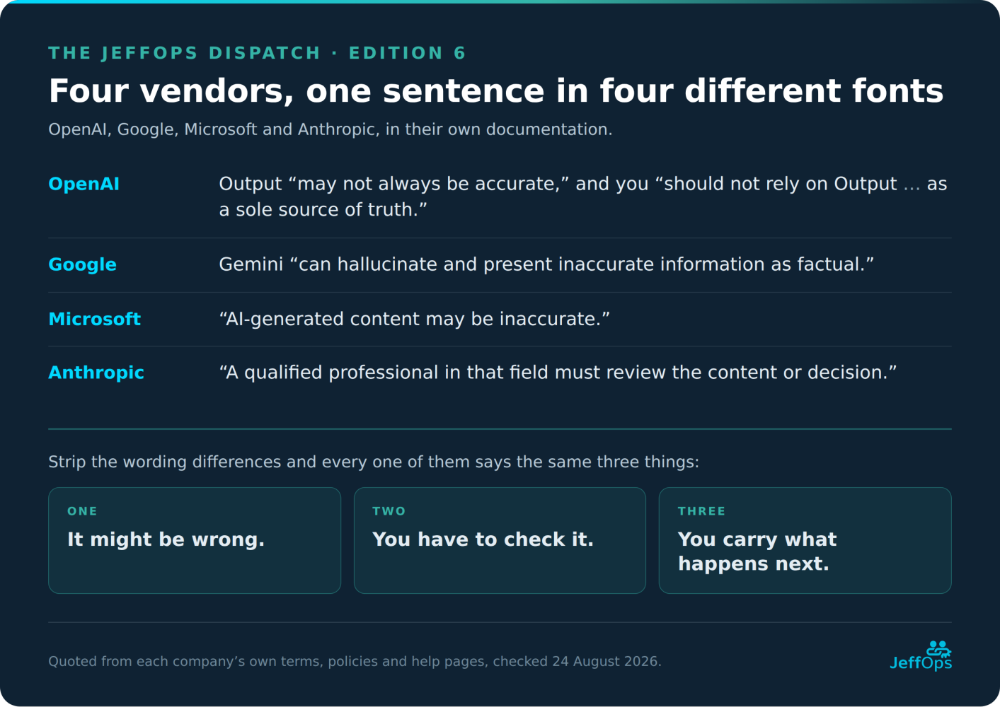

Twice in this series I have gone looking for the person who carries the blame when AI gets it wrong. In the accountability edition I gave the vendor’s disclaimer exactly one paragraph and moved on. In the last edition I put a human in the loop and watched them turn into a blame sponge. Then I went and read the actual contracts, and I owe that one paragraph a whole article.

So this one is for the person who signed off on an AI tool for their team, and for the people on that team who now have to use it. You don’t need to be a lawyer for any of it. I’m not one either.

Here’s the claim, and the best part is that I don’t have to argue for it. The vendors have already written it down: every wrong answer is yours. It’s sitting in their terms of service right now, in plain language, waiting for anyone who bothers to read past the marketing. And I say that as someone who had never properly read one of these until I sat down to write this. So before I take a swing at anyone else, that one is on me.

Line them up and it’s the same sentence in four different fonts. OpenAI, Google and Microsoft all telling you, in their own documentation, that the thing might be wrong and you’re the one who has to check. And Anthropic, which requires human oversight for anything high-stakes, and which we’ll get to, because it’s a more interesting case than it first looks.

That’s not a warning. A warning is the vendor helping you. This is the vendor stepping out of the way. It’s a transfer of custody, and you accept it the moment you hit enter.

Let me show you exactly what you’re accepting.

## What the disclaimer actually does

A disclaimer feels like fine print. Legally, it’s load-bearing. It’s doing three specific jobs and none of them are for your benefit.

Start with the warranty. Normal products come with an implied promise that they’re fit for the purpose you bought them for. These terms strip that out, in capital letters, so nobody can say later that they missed it. There is no promise it works. There is a documented statement that it might not.

Then the number, and the number does the arguing for me. A hundred dollars. If the product confidently hands you a wrong figure and it costs you a client, a contract or a lawsuit, that is the formal ceiling on their share of it. Not because a hundred dollars covers the damage. Because they’ve decided, in advance, that the damage isn’t theirs.

Then the assignment, and look at the word they picked. Solely. Not “shares responsibility.” Not “we’ll help.” Solely yours.

That’s the whole arrangement, and it isn’t even hidden. It’s just in the document nobody reads. Including me, apparently.

## “Verify everything” is a confession, not advice

Now look at the instruction buried in all of these terms. OpenAI: “You must evaluate Output for accuracy and appropriateness for your use case, including using human review as appropriate, before using or sharing Output from the Services.” Google tells you to double-check every response. On the surface that reads like responsible guidance.

It isn’t. It’s a confession.

When the company that built the product tells you to check all of its output, they are not coaching you towards best practice. They are putting on the record, in a binding document, that the output cannot be trusted on its own. They’ve documented the unreliability. And in the same breath they’ve assigned you the duty to catch it. Perfect arrangement, from their side! They get to ship something that makes things up, and they get to point at your signature when it does.

That’s the unkind version, so here’s the kind one next to it, because it’s just as true. They can’t check your work. They don’t know your use case, they can’t see the situation the output is going into, and no vendor on earth could carry unlimited liability for a general-purpose tool sold to millions of people who all use it differently. Every word of that is fair. But notice what none of it changes. A limitation they cannot avoid and a liability ceiling they chose are two different kinds of thing, and only one of them had to be a hundred dollars.

Here’s the part that should make you angry, and it connects straight back to the last two editions. “Verify everything” sounds fair right up until you remember two things. One: the illusion of competence. AI fails convincingly, so you cannot reliably spot the wrong ten per cent, because the wrong ten per cent looks exactly like the right ninety. Two: verification at real volume is often impossible, and a reviewer who can’t keep up is a rubber stamp, not a safeguard.

So the vendor has handed you a duty that the nature of their own product makes impossible to discharge. “Verify everything” is not a safety instruction. It’s liability scaffolding dressed as one. They know you can’t catch every error. That’s precisely why the clause is there. It makes sure that when you inevitably miss one, the failure is documented as yours.

## The professional they refuse to be

There’s a comparison that makes the whole thing land, so let me be blunt with it.

A structural engineer signs off on a building. When they stamp those drawings they are personally, professionally and legally on the hook for them. If it fails, that stamp is why the liability finds them. An accountant signs the return. A doctor owns the diagnosis. A lawyer stands behind the advice. That is what the word “professional” actually means. It doesn’t mean “good at the job.” It means carrying the responsibility for the work. The accountability is the profession.

Now look at what these tools get sold as. Cognition launched Devin on 12 March 2024 as “the first AI software engineer,” and called it “a tireless, skilled teammate, equally ready to build alongside you or independently complete tasks for you to review.” Salesforce announced Agentforce 2.0 on 17 December 2024 as “The Digital Labor Platform for Building a Limitless Workforce,” and still sells “24/7 autonomous support at enterprise scale.” 11x puts its product under the heading “Hire our Digital Workers.” Artisan spent, by its own account, two million dollars on billboards reading “Stop Hiring Humans.” And the cleanest example isn’t a startup billboard at all, it’s a headline OpenAI ran on its own website: “Klarna’s AI assistant does the work of 700 full-time agents.”

Now, the obvious objection, and it’s a good one: nobody is marketing an AI paralegal or an AI analyst as a person-substitute. I went looking and I couldn’t find it either. What I found instead was a legal AI vendor publishing a page titled “Will AI Replace Paralegals? No, Just Their Tedious Work.” Microsoft named the whole product a Copilot, which is a seat next to the pilot rather than instead of it, and that naming is doing real work. Next to that, the loudest three all walked it back: Artisan retired the slogan in August 2026 and is hiring its first human BDR, Klarna’s CEO now says “investing in the quality of human support is the way of the future for us,” and Cognition’s site today says Devin “helps developers build better software faster.” “Replace” is the one word this industry handles with tongs.

Which narrows my claim, and I’d rather have the narrow one, because it’s the true one. Nobody has to say “replace.” Look at the nouns they reach for anyway. Engineer. Worker. Labour. Workforce. Agent. Hire. Every one of those is a job word, and you don’t hire a text generator. That’s the authority I’m talking about, and it gets borrowed in the campaign and disowned in the contract.

And there’s a second half to that objection which is the whole article in one sentence: marketing that promised outright replacement wouldn’t survive contact with the disclaimer. Exactly right. The contract is the constraint on what the marketing is allowed to say out loud. So it gets said with nouns instead.

It wants to be treated as the expert in the advertisement and as a random text generator in the contract. It wants the authority of a professional and the liability of a Magic 8-Ball. Would you take that deal from the engineer who stamped your drawings? Of course not! No actual professional gets both.

## The Microsoft twist: when the admission got inconvenient

Now for the part that made me want to write this at all, and it comes with a correction to the version I had in my head when I started.

You’d expect that as these products got more capable, the vendors would grow more confident and maybe soften those disclaimers. Watch what actually happened instead.

Two moves in fourteen months, and the product’s reliability was not what moved either time.

To be fair to Microsoft, they never said it was. Nobody stood up in November 2025 and announced that the model had stopped being wrong. That’s exactly what I’m pointing at. The reliability wasn’t in the conversation at all. The thing being tuned, in both directions, was how much doubt reaches the user, and it got tuned first for how the product feels to use and then for what administrators asked for. Neither reason has anything to do with how much doubt is warranted. That is the disclaimer shield showing its purpose. The perfect disclaimer, from a vendor’s side, is one that transfers all of the liability and none of the doubt.

Just to be very clear about what I’m claiming and what I’m not. Microsoft’s own pages currently disagree with each other about the default state, so I could not settle it from the documentation, I haven’t tested it in a tenant, and I’m not going to tell you what your own users are seeing today.

And there’s a fair objection sitting right here, which is that a one-line disclaimer was never going to teach anybody how to use a tool properly. That’s the organisation’s job: explain why you brought the thing in, what it’s for, and where it stops. Completely agree, and it’s where this whole argument ends up anyway. But hold both halves. The organisation owes its people that training, and the vendor’s clause is written as though the warning already did it.

Credit where it’s due, though: the disclaimer came back because organisations pushed for it. Customers asked for the honesty to be visible, and it became visible. Worth remembering the next time somebody tells you these defaults are out of your hands.

## A fair word on the vendor who does it differently

I said I’d come back to Anthropic, and their Usage Policy is a genuinely different case.

For high-risk use cases, which they list as legal, healthcare, insurance, finance, employment and housing, academic admissions and journalism, they don’t just say “verify everything, at your own risk.” They require this:

“When using our products or services to provide advice, recommendations, or in subjective decision-making directly affecting individuals or consumers, a qualified professional in that field must review the content or decision prior to dissemination or finalization.”

Next to that they require disclosure, at the start of every session, that an AI was involved at all. That is a more responsible posture than a blanket sole-risk disclaimer, and credit where it’s due.

But turn the same sceptical lens on it that this series turns on everyone, and read the next sentence of that same clause: “You or your organization are responsible for the accuracy and appropriateness of that information.”

Two objections to what I just did, and I’ll take both.

The first: a qualified professional was already reviewing those decisions. If your organisation is deciding who gets hired or who gets a loan without one, an AI vendor’s policy is the least of your problems. Fair. Anthropic isn’t installing a human where none existed. It’s writing down the one you already employ.

The second: that clause has borders. It names the domains, it names the trigger, and nobody at Anthropic is telling you to run every little thing past a professional. That’s what a good policy looks like, and it’s more than the others offer.

So let me narrow it to the bit that survives, because something does. It was never that a human reviews. It’s what the review is worth after the volume changes. The professional who signed off on ten of these a week is now signing off on ten before lunch, and I spent an entire edition on what happens to that person: they become a moral crumple zone, in Madeleine Clare Elish’s phrase. A named person positioned to absorb the blame the system was designed to shed. Anthropic drew its border around which decisions need a human. There is no border around how many of them one human can actually carry.

So the better stance and the worse stance still arrive at the same place by different roads. One vendor caps its liability at a hundred dollars. The other writes down that the professional you already employ owns the output. Neither of them is holding the outcome when it breaks.

You are.

## One honest caveat, and it moved while I was writing

These disclaimers are not magic spells. “At your sole risk” is what the vendor wrote, not automatically what the law allows. Here in the Netherlands, a clause that excludes or limits a supplier’s liability towards a consumer sits on the black and grey lists of Book 6 of the Civil Code, with European unfair-terms law behind it. A hundred dollar ceiling does not reliably survive contact with that.

The AI Act is the part I had to rewrite. I had it in my head that the high-risk duties, human oversight included, were landing this summer. They aren’t. The Digital Omnibus on AI, Regulation (EU) 2026/1744, entered into force on 27 July 2026 and pushed the high-risk chapter back to 2 December 2027 for the Annex III systems and 2 August 2028 for Annex I. What did start this month is the transparency duty in Article 50: tell people they are dealing with an AI, mark synthetic content.

Which sharpens the point rather than blunting it. For the next fifteen months and more, those terms of service are doing more work than they can legally bear, and the statutory duties that would push some of the weight back up the chain are not in force yet. That gap is exactly where you are standing.

So the law will claw some of it back, eventually, in some places. The vendor’s intent is not in any doubt at all, today, everywhere: push the entire outcome downstream to you. The disclaimer tells you what they will fight for. Believe them.

## Own only what you can carry

So read the terms. Not as legalese to scroll past, but as the single most honest description of the product you will ever get. The marketing tells you what they hope it does. The terms of service tell you what they’ll swear to in court. When those two documents contradict each other, and they always do, believe the one the lawyers wrote.

And once you believe it, the decision rule writes itself. If custody of every outcome lands on you, then only use these tools where you can genuinely carry that. Verifiable tasks. Low stakes. Recoverable mistakes. The exact tasks that pass the AI Fit Test, which is the ground this whole series has been pointing at.

Then price the transferred risk in, literally. The decision model from the plotting edition was Value = (time saved x frequency) - (cost of errors x risk). The disclaimer is the vendor putting in writing that the entire cost-of-errors term is yours, capped on their side at a hundred dollars. So carry that number into the sum honestly, because a “free” tool that hands you unlimited downside was never free.

And don’t do to your own people what the vendor did to you. Don’t accept the custody and then quietly pass the parcel down to whoever clicked the button. Hold the risk where the decision actually got made.

So why do I still use these things every single day, having spent two thousand words on the contract that says every wrong answer is mine? Fair question, and it’s the right one to end on. Because I’m not asking the tool to be a professional. I’m asking it to draft, to summarise, to refactor, to get me unstuck on a normal Tuesday, all of it on work I was going to own anyway. The custody transfer only stings when you were hoping to hand something over. I never was. Neither should you be 😉

They sell it as a replacement. They disclaim it as a tool. They cannot have both, and the contradiction is the whole tell. Until they’re willing to sign their name to the outcome the way a real professional does, read their product the way they’ve written it down: not something to hand your responsibility to, but something to enhance work you still own.

A tool to enhance, not to replace. Their own lawyers agree with me. Own only what you can carry.
